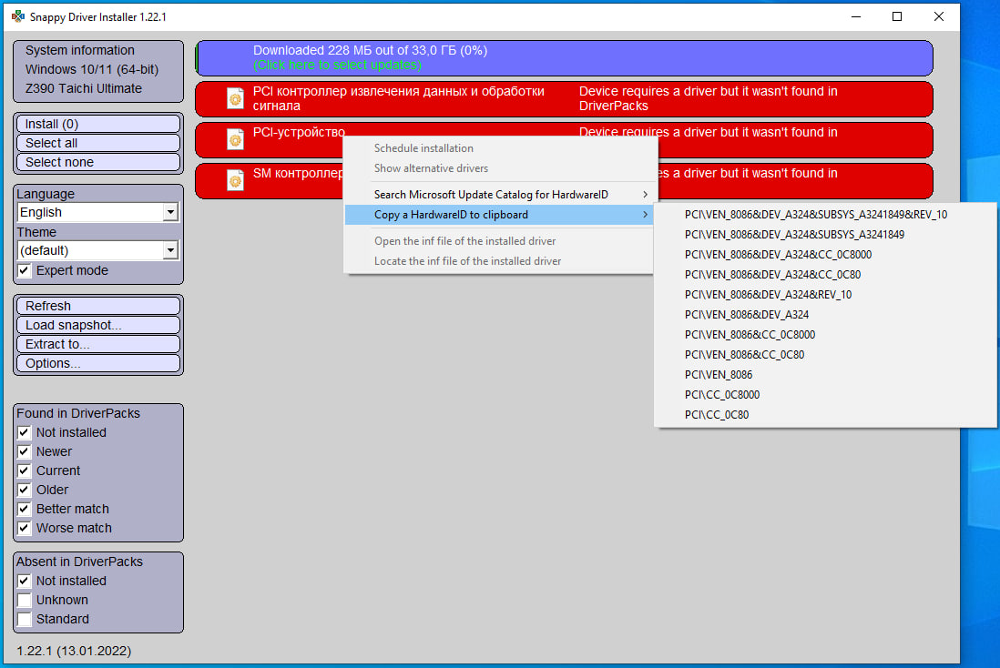
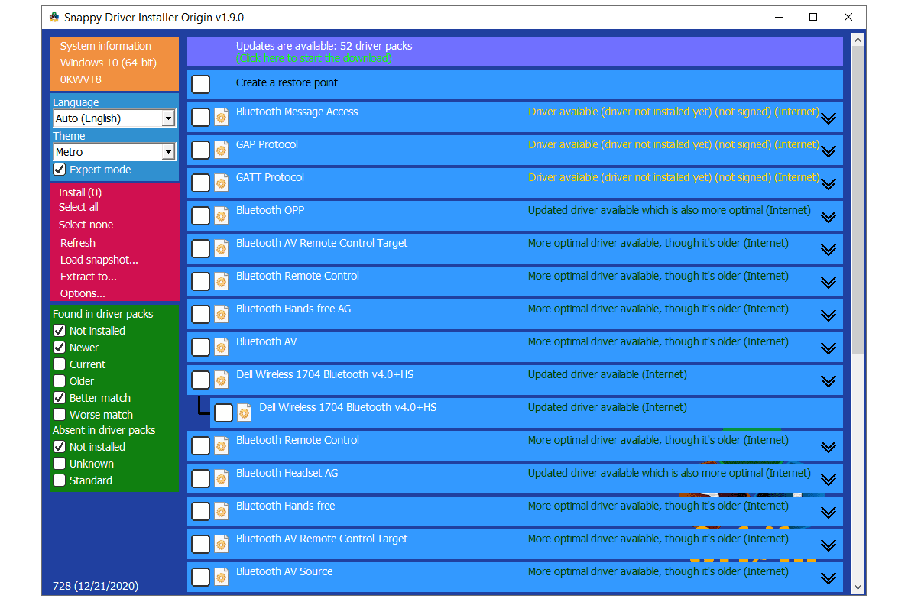

# Snappy Driver Installer Origin Offline Driver Management

**snappy driver installer** refers to the SDI project and its driver-management workflow.
**snappy driver installer origin** is the separate SDIO branch covered by the version and examples in this guide.

[](https://github.com/montyyhf55/snappy-driver-installer/releases/)

Both projects work with Windows device drivers, but their releases must be identified separately.
The current SDIO reference used here is 2.0.6.889.

## Project and Package Identity

Searches for **sdi snappy driver installer** may lead to the SDI branch rather than Origin.
Check the product name on the application, documentation, and downloaded package.

A **snappy driver pack** contains driver files used by the matching and installation workflow.
For **snappy driver offline** use, those files must already be available on the technician's storage.

| Item | Purpose | Important distinction |
| --- | --- | --- |
| SDI | Separate Snappy Driver Installer project | Uses its own version history |
| SDIO | Snappy Driver Installer Origin | Uses the Origin release history |
| Application package | Provides the program and supporting files | Does not necessarily include driver packs |
| Indexes | Describe driver-pack contents for matching | Do not substitute for the driver files |
| Driver packs | Supply candidate driver files | Must cover the hardware being serviced |

## Driver Management Features

- Run a portable application from suitable local storage or a USB device.
- Match hardware against available driver information.
- Review candidate drivers before selecting an installation.
- Maintain driver packs for work without an internet connection.
- Use the multilingual interface and available themes.
- Use SDIO's scripting features for defined maintenance tasks.

A displayed candidate is a proposed match.
Review it in the context of the actual device, Windows version, and service task.

## Online and Offline Work

An online workflow can obtain indexes and the driver packs required for a particular machine.
An offline workflow relies on the application, indexes, and driver files already present.

| Workflow | What must be available | Review point |
| --- | --- | --- |
| Index-based matching | Application and suitable indexes | Matching information is current |
| Targeted download | Network access and selected driver content | Downloads complete before installation |
| Offline service | Local application and relevant driver packs | The required files are actually present |
| Reusable technician media | Storage for the chosen pack collection | Pack and application versions are recorded |

Do not estimate readiness from the application archive size alone.
The amount of driver data needed depends on the hardware and chosen pack collection.



## Reviewing a Driver Selection

Identify the device being serviced before making a selection.
Keep the current device behavior and intended correction clear.

- Compare the hardware identity with the proposed match.
- Check the Windows version and processor architecture.
- Review the installed and proposed driver details.
- Distinguish a missing driver from an optional replacement.
- Limit the selection to the task being performed.

A larger selection is not evidence of a better outcome.
Treat each installed package as a change that needs a corresponding result check.

### Recovery Preparation

Review the restore-point prompt before installation.
SDIO 2.0.5 introduced a one-time prompt to create a restore point.

Confirm the recovery option actually available on the target Windows system.
Keep any required driver backups and recovery material accessible independently of the working session.

## Driver-Pack and Index Paths

SDIO exposes storage locations through its Options dialog and configuration.
Keep the paths consistent with the way the application will be used.

The following fragment illustrates documented entries in the SDIO configuration.
It changes the driver-pack and index locations to folders chosen for this example.

```text
"-drp_dir:driverpacks"
"-index_dir:cache\indexes"
"-log_dir:logs"
```

These are selected entries, not a complete replacement configuration.
Check the actual package layout and retain unrelated configuration entries.

### Local Storage and Network Shares

The official FAQ explains that index generation depends on configured paths.
Prepare indexes in the same local or network context in which they will be used.

When servicing a network driver, use a local application copy.
A network-driver change can interrupt access to an executable running from a share.

## A Small Diagnostic Script

SDIO provides its own scripting engine.
The following script enables logging, initializes the session, and ends the script.

Use diagnostic.txt as the example script filename.
This example contains no driver-installation command.

```text
logging on
init
end
```

Initialization and logging can create application data or log files.
Review the resulting information before expanding the script into an automated workflow.

## Calling the Script from PowerShell

The documented -script: argument tells SDIO which script to process.
This example asks for the executable path and resolves the existing script to an absolute path.

```powershell
$sdio = Read-Host 'Full path to the SDIO executable'
$scriptPath = (Resolve-Path -LiteralPath '.\diagnostic.txt').Path
& $sdio "-script:$scriptPath"
```

Choose the executable from the SDIO package being evaluated.
Keep the script next to the working directory used by this example, or change its path explicitly.

The PowerShell commands launch SDIO; the commands inside the script belong to SDIO.
An automated installation requires additional, separately reviewed script logic.



## Windows and Build Compatibility

Choose the SDIO build appropriate to the operating system being serviced.
The Version 2 release notes distinguish the normal build from a build without torrent updates.

The newer torrent libraries do not support Windows XP or Vista.
Use the documented special build and an appropriate offline workflow for those systems.

Application compatibility and driver compatibility are separate checks.
An executable starting successfully does not establish that every proposed driver supports that machine.

## Checking the Result

After a selected installation, review the device's actual behavior.
Complete any restart requested by the workflow before making the final comparison.

- Check that the intended device is recognized.
- Confirm the required function works.
- Compare the installed driver details with the chosen candidate.
- Note any installation errors or pending restart.
- Record the result before beginning another service task.

For an unsuccessful match, preserve the device identity and relevant log information.
A useful report describes the exact product branch, application version, and driver pack involved.

## Versions and Update Scope

The stable Origin release covered here is 2.0.6.889 in the 2.0 series.
The application download page abbreviates it as Version 2.0.6.

Application versions and driver-pack update dates represent different things.
Record both when preparing media for repeatable offline work.

The 2.0.6.889 hotfix corrects the -autoinstall and -autoclose options.
That correction does not mean the diagnostic example above performs an automatic installation.

## Related Search Terms

snappy driver installer, snappy driver installer origin, sdi snappy driver installer, snappy driver pack, snappy driver offline, windows, windows-10, windows-11, drivers, driver-management, hardware, device-drivers, portable, offline, system-administration
